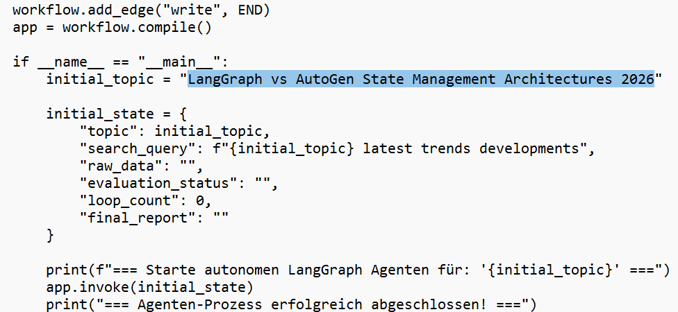
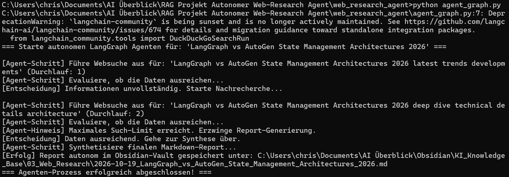
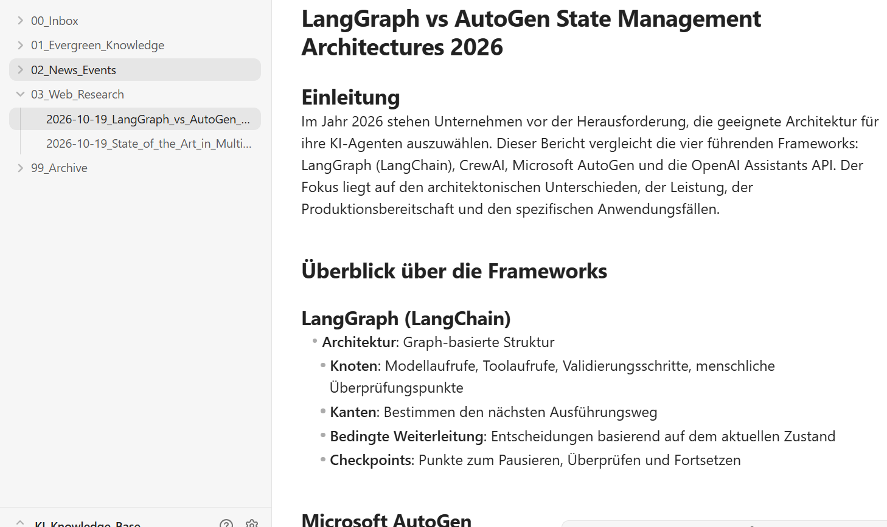

# 🤖 Web-Research-Agent mit LangGraph und Obsidian-Anbindung

Ein Recherche-Agent, der zu einem Thema im Web sucht, die Ergebnisse per LLM bewertet, bei Bedarf die Suche verfeinert und einen Markdown-Report direkt in einem lokalen Obsidian-Vault ablegt.

---

## Rolle & Entwicklungsansatz

* **Rolle:** Christoph Bauer, Business Analyst: Anforderungen, Ablauf- und Zustandslogik (Schleifen, Bewertung, Abbruchkriterien), Anbindung an Obsidian und Test.
* **Umsetzung:** Den Python-Code habe ich mit KI-Coding-Assistenten erstellt und anschließend getestet und angepasst.

*Setup:* Lokale Pfade und API-Schlüssel liegen in einer `.env`-Datei (über `python-dotenv`) und sind nicht im Repository enthalten.

---

## Ziel

Wiederkehrende Web-Recherchen sollen mit weniger Handarbeit zu einem strukturierten Ergebnis führen, das direkt in der eigenen Wissensbasis (Obsidian) landet. Der Agent soll dabei selbst erkennen, ob die gefundenen Informationen ausreichen.

---

## Tech Stack

* **Sprache:** Python 3.10+
* **LLM:** OpenAI `gpt-4o-mini` (über LangChain Core / ChatOpenAI)
* **Agenten-Framework:** LangGraph (Zustandsgraph mit bedingten Verzweigungen)
* **Websuche:** DuckDuckGo (`duckduckgo-search`), ohne API-Schlüssel
* **Ablage:** Obsidian-Vault über `pathlib`

---

## Stufe 1: Linearer Agent (MVP)

Die erste Version (`linear_research_mvp.py`) läuft strikt nacheinander ab:

1. **Initialisierung:** `.env` laden, Suchwerkzeug und LLM bereitstellen.
2. **Websuche:** Eine feste Suchanfrage zum Thema über DuckDuckGo.
3. **Zusammenfassung:** Das LLM erstellt aus den Suchergebnissen einen strukturierten Report.
4. **Ablage:** YAML-Frontmatter (Datum, Tags, Aliase) erzeugen und die `.md`-Datei im Vault speichern.

*Grenze:* Die lineare Version konnte nicht erkennen, ob die Suchergebnisse lückenhaft waren, und die Suche nicht nachbessern.

---

## Stufe 2: Bewertungsschleife mit LangGraph

Die zweite Version (`web_research_agent.py`) ist als Zustandsgraph aufgebaut:

* **Zustand (`ResearchState`):** Thema, Suchanfragen, gesammelte Daten, Bewertung und Schleifenzähler (`loop_count`).
* **Bewertung:** Nach der Suche entscheidet das LLM, ob die Daten ausreichen (`"READY"`) oder die Suche verfeinert werden soll (`"REFINE"`).
* **Abbruchkriterium:** Höchstens 2 Durchläufe (`loop_count >= 2`), damit keine Endlosschleifen und unnötigen API-Kosten entstehen.
* **Bedingte Verzweigung:** Bei unvollständigen Daten geht es zurück zur Suche, sonst zum Schreiben des Reports.

```text
[Websuche] ---> [Daten bewerten]
                      |
        ┌─────────────┴─────────────┐
   (Daten OK)                  (Mehr Info nötig)
        ▼                           ▼
[Report schreiben]           [Suchanfrage verfeinern] ---> (zurück zur Websuche)
```



---

## Ausführung und Ergebnis



Der Report wird mit YAML-Frontmatter als Markdown-Datei im Obsidian-Vault abgelegt:



---

## Learnings

* **Erst MVP, dann Komplexität:** Die lineare Version hat die Grundfunktion abgesichert, bevor die Schleifenlogik dazukam.
* **Schleifen machen den Unterschied:** Erst durch die Bewertung und den möglichen Rücksprung kann der Agent fehlende Informationen nachholen.
* **Abbruchkriterien sind Pflicht:** Ohne feste Obergrenze erzeugen solche Agenten schnell unnötige API-Aufrufe.
* **Direkt nutzbares Ergebnis:** Durch das passende Format für Obsidian ist der Report sofort durchsuchbar und verlinkbar.

---

## Repository-Struktur

```text
├── Scripts/
│   ├── web_research_agent.py       # Agent mit Bewertungsschleife (LangGraph)
│   └── linear_research_mvp.py      # Erste, lineare Version
├── Pictures/
│   ├── langgraph-agent-workflow-code.png
│   ├── agent-execution-terminal-log.png
│   └── obsidian-vault-generated-report.png
├── requirements.txt
└── README.md
```
